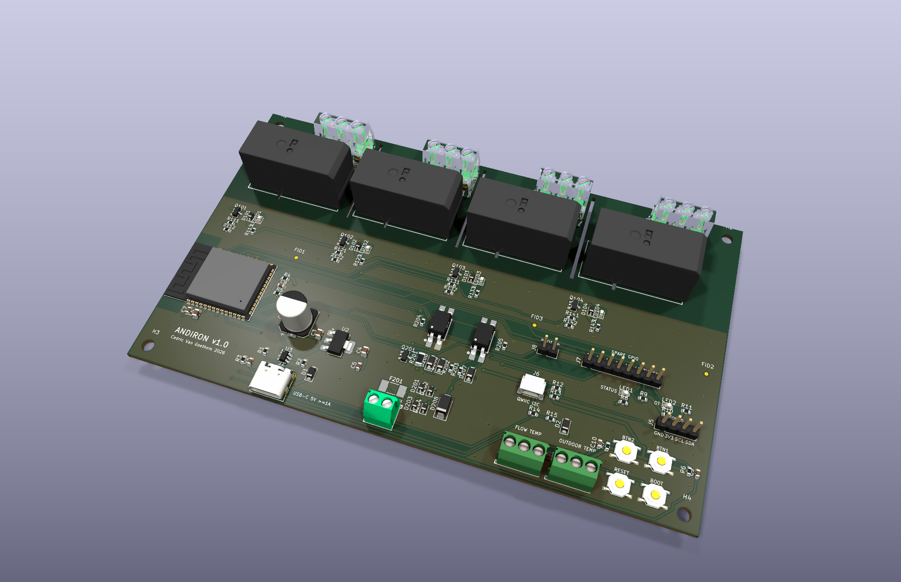
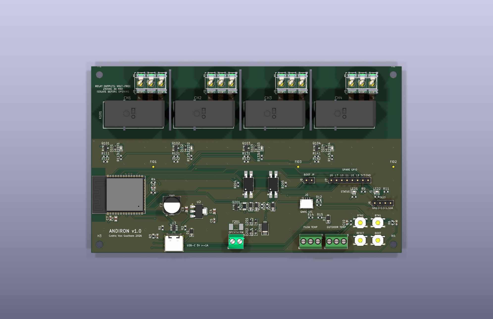
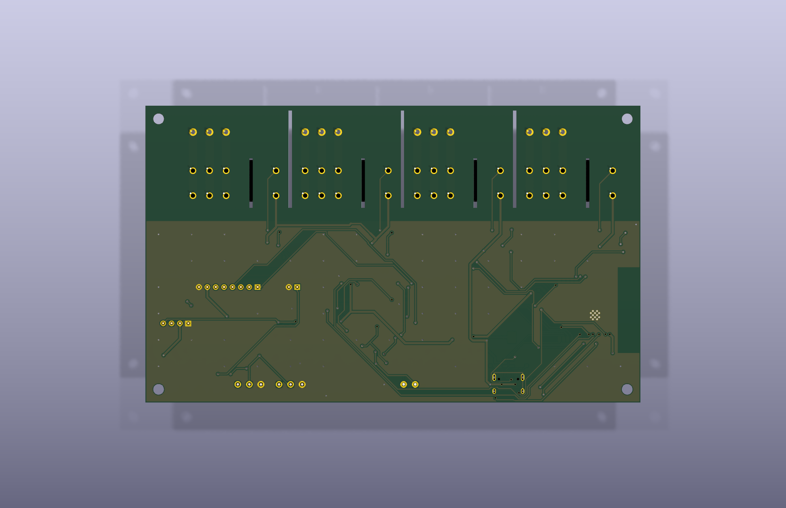
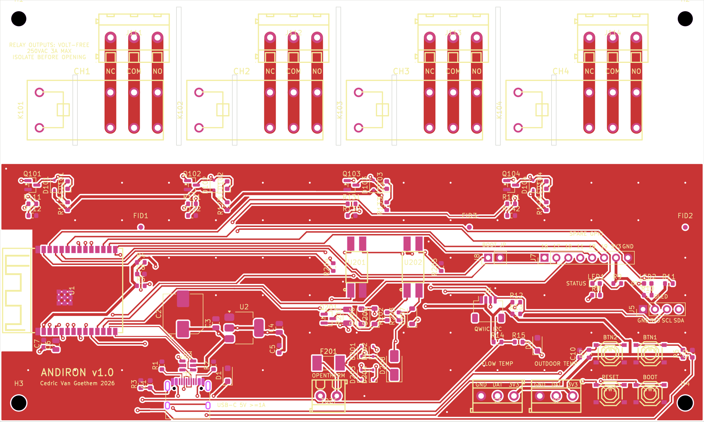
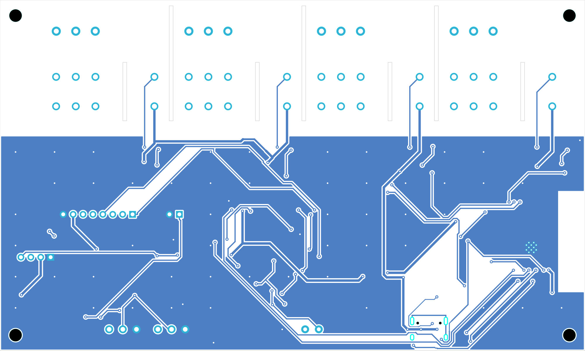

# Andiron

**ESP32-C6 heating controller for a UK wiring centre, built for Home Assistant and ESPHome.**
Board revision v1.0



Andiron is an isolated I/O board for a domestic heating system. It sits in the
wiring centre, switches the zone valves and boiler demand through four
volt-free changeover relays, and talks to the boiler over OpenTherm. All the logic (schedules, thermostats, weather compensation) lives
in Home Assistant. The board was designed around an ESPHome firmware, which
will be written and published once the first boards are in hand.

| | |
|---|---|
| MCU | ESP32-C6-WROOM-1 (WiFi 6, BLE), USB-C power and programming |
| Boiler | OpenTherm master (opto-isolated, fused against a 230 V miswire) |
| Outputs | 4 × volt-free changeover relays (CH1–CH4), NC / COM / NO terminals, 250 VAC 3 A, each channel isolated from the others |
| Sensors | 2 × 1-Wire probe terminals (flow, outdoor), Qwiic I²C, OLED header, 8-pin spare GPIO header |
| Board | 150 × 90 mm, 2 layers, 6.4 mm isolation around every relay channel, JLCPCB assembly |

> **Mains voltage.** The relay contacts can switch 230 V. Do not build or
> install it unless you are competent to work on mains wiring, and read the
> safety notes in [`docs/design.md`](docs/design.md) first. Status: v1.0 passes
> ERC, DRC and the spacing checks, but no board has been built or tested yet.

## Renders

| Top | Bottom |
|---|---|
|  |  |
|  |  |

The 3D views use stand-in models for the ESP32-C6 module (ESP32-S3-WROOM-1,
same body) and the USB-C receptacle (GCT USB4105, same footprint).

## Bill of materials

The full BOM with LCSC part numbers and cost estimates is in
[`docs/BOM.md`](docs/BOM.md); the JLCPCB upload file is
[`docs/bom/andiron-bom-jlc.csv`](docs/bom/andiron-bom-jlc.csv). At LCSC prices
from October 2026, components came to roughly $24 per board, or about $37 per
board for a run of five once Extended-part loading fees are included. The four
relays are $14 of that. PCB,
assembly and shipping come on top, from the JLCPCB quote.

## Getting started

### Tools

| Tool | Used for |
|---|---|
| [KiCad 10](https://www.kicad.org/) | schematic, layout, DRC, renders (`kicad-cli`) |
| [Konnect](https://github.com/mixelpixx/Konnect) MCP server (0.13, KiCad 10 plugin) | lets Claude Code read and edit the KiCad project, search the JLCPCB parts database |
| [Freerouting](https://github.com/freerouting/freerouting) 2.x + Java | autorouting |
| [easyeda2kicad](https://github.com/uPesy/easyeda2kicad.py) | importing JLC/LCSC symbols, footprints and 3D models into `lib/` |
| Python 3 | the scripts in `tools/` |

### Working on the board with Claude Code and Konnect

1. Install KiCad 10 and Konnect, and put `konnect` on your `PATH` (or point
   [`.mcp.json`](.mcp.json) at it).
2. Open the repository in Claude Code and approve the Konnect server when
   asked. Claude can then read and edit the schematic and board, run ERC and
   DRC, and search JLCPCB parts.
3. Ask Konnect to download the JLCPCB parts database once
   (`download_jlcpcb_database`); `tools/bom.py` reads the same file for prices.
4. Start with [`docs/requirements.md`](docs/requirements.md) and
   [`docs/design.md`](docs/design.md) for what the board does and why.

The layout is generated, not drawn by hand: part positions live in
`tools/layout/place.py`, shared dimensions (relay row, terminals, isolation
zones, slots, antenna keep-out) in `tools/layout/geometry.py`, and hand-laid
copper in `tools/route/prep_board.py`. Edit those and rerun the pipeline rather
than moving tracks in the PCB editor.

### Regenerating outputs

```sh
KPY=/Applications/KiCad/KiCad.app/Contents/Frameworks/Python.framework/Versions/Current/bin/python3
$KPY -I tools/sync_netlist.py "$PWD" tools/route/placed.kicad_pcb   # after a schematic change
$KPY -I tools/layout/place.py tools/route/placed.kicad_pcb          # after a placement change
tools/route/run_pipeline.sh "$PWD" 40    # route, pour, silkscreen, DRC, sanity (close the PCB editor first)
python3 tools/bom.py                     # docs/BOM.md and docs/bom/andiron-bom-jlc.csv
tools/render.sh                          # docs/images/
```

## Repository layout

| Path | What |
|---|---|
| `heating-controller.kicad_pro` / `.kicad_sch` / `.kicad_pcb` | KiCad 10 project (root sheet plus `power_mcu`, `opentherm`, `relays`) |
| `heating-controller.kicad_dru` | custom DRC rules: mains isolation, clearances, track widths |
| `.konnect/project.json` | design rules in prose, read by Konnect during layout |
| `lib/` | project symbols, footprints and 3D models (from JLC/EasyEDA) |
| `docs/requirements.md` | numbered requirements (what) |
| `docs/design.md` | decisions, safety framing, GPIO map, layout, open questions (why) |
| `docs/layout-notes.md` | what worked and what did not in placement and routing |
| `docs/BOM.md`, `docs/bom/` | bill of materials and JLCPCB upload file |
| `tools/` | routing pipeline, BOM, renders, 3D model sync, checks; see [`tools/README.md`](tools/README.md) |

Open questions that must be answered before ordering are at the end of
[`docs/design.md`](docs/design.md); the boiler model code is the main one.

## License

Open hardware. The board design and documentation are licensed under the
[CERN Open Hardware Licence v2, Permissive](LICENSES/CERN-OHL-P-2.0.txt), the
hardware counterpart of MIT; the scripts in `tools/` are under the
[MIT License](LICENSES/MIT.txt). See [`LICENSE`](LICENSE).

